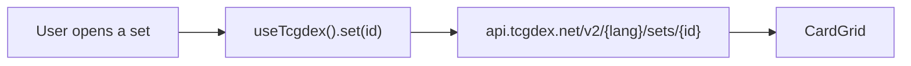

# Clear PR description

Goal: a reviewer understands the PR in two minutes. English, short sentences, no filler. Diagrams over paragraphs. `.github/pull_request_template.md` has the same sections.

## Template

Keep these sections, in this order. Drop a section only where noted.

````markdown
## Purpose
<1-2 sentences: the problem and what this PR does about it. Link the intent: "Intent: `docs/intents/0003-catalog.md`", plus "stacked on #N" if any.>

## What it touches
- `supabase/...`: <one line>
- `web/...`: <one line>
- `mobile/...`: <one line>
- DB: <migration name, or "no schema change">
- Docs/config: <only if any>

## Idea and implementation
<The design in a few lines, then the diagram(s).>



<Why this way, only if not obvious. Alternatives rejected in one line each.>

## Risks
- <What could break, who is affected, how to roll back. "None known" only if you checked.>

## Things to check
- [ ] <something not verified yet>
- [ ] <something not verified yet>

## Screenshots
<Drop this section when the PR has no visible change.>
````

## Rules per section

- **Purpose:** the why, not the file list. One intent link.
- **What it touches:** one bullet per area, path in backticks, a few words each. Mention migrations, RLS policies, Edge Functions, new env variables. Say if web/mobile parity is intentionally broken (README rule 5).
- **Idea and implementation:**
  - Pick the diagram that fits: `flowchart` for flow or architecture, `sequenceDiagram` for calls between client, Supabase and TCGdex over time, `erDiagram` for schema changes, `stateDiagram-v2` for status changes. One to three diagrams per PR, each with at most ~10 nodes.
  - Label edges when the meaning is not obvious. Quote node text that has spaces or symbols: `A["POST /rest/v1/collection (RLS)"]`. Plain Mermaid, no custom styling, so it renders in light and dark mode.
  - GitHub renders each diagram in a fixed-height box: prefer `LR` direction and short labels; use `direction LR` in `erDiagram`.
  - Under each diagram, at most 3 lines: the key decision and why. No line-by-line walkthrough.
  - For a refactor, show before and after.
- **Risks:** concrete (RLS leak, data loss, wrong set progress or totals, TCGdex rate limits, migration order). Add the mitigation or rollback in the same bullet.
- **Things to check:** one item per README quality command for the touched areas, browser/emulator checks per acceptance criterion, "no secrets committed", "UI strings in IT and EN". Write what to check and how, so a reviewer can do it.

## Keep "Things to check" up to date

The list is live. Whenever you verify an item (test run, build, browser flow, emulator, CI, review):

1. Read the current body (the `--attach` upload and the reviewer may have changed it): `gh pr view <n> --json body --jq .body > body.md` (use the scratchpad).
2. Edit only the list in `body.md`:
   - passed: `- [x] <item>: <result in a few words>`
   - failed: keep `- [ ]` and add `FAILED: <first error line>`
   - new thing to check discovered: add `- [ ] ...`
3. Publish: `gh pr edit <n> --body-file body.md`.

Do this right after each verification step, not once at the end. When everything is checked, the list is all `[x]`; leave it in place as the record. Also mirror the results in section 7 of the intent.

## Screenshots

- Only for visible changes. Real screens, not a cropped component or a mock-up.
- **Web:** desktop (800 px wide) and mobile (375 px wide). Shoot the production build so the Nuxt devtools overlay is not in the picture: `bun run build && PORT=3000 node .output/server/index.mjs`. Headless Chrome works without a browser session:
  ```bash
  "/Applications/Google Chrome.app/Contents/MacOS/Google Chrome" --headless=new --hide-scrollbars \
    --window-size=800,600 --screenshot=desktop.png http://localhost:3000/<page>
  ```
- **Mobile:** a simulator or emulator screenshot of the changed screen, in the default locale.
- Attach them to the PR:
  ```bash
  gh pr edit <n> --attach './desktop.png#Desktop: <what it shows>' --attach './mobile.png#Mobile: <what it shows>'
  ```
  Put `` in the body under "Screenshots"; `gh` rewrites it to the uploaded image. No screenshots branch, no images committed.
- Re-attach after a visible change, and read the body first (step 1 above) so you do not overwrite edits.

## Checklist before publishing

1. Every section present, in order.
2. The diagrams render (check the PR page, not only the source).
3. Every "Things to check" item is either `[x]` with its result or `[ ]` with how to check it.
4. Body is English.
